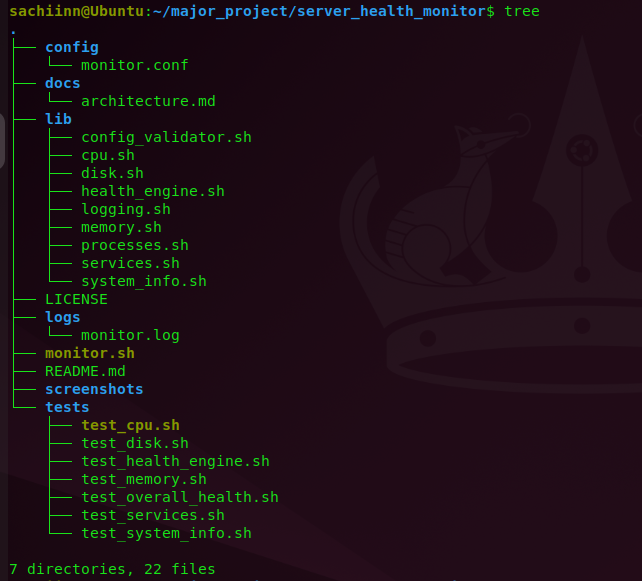
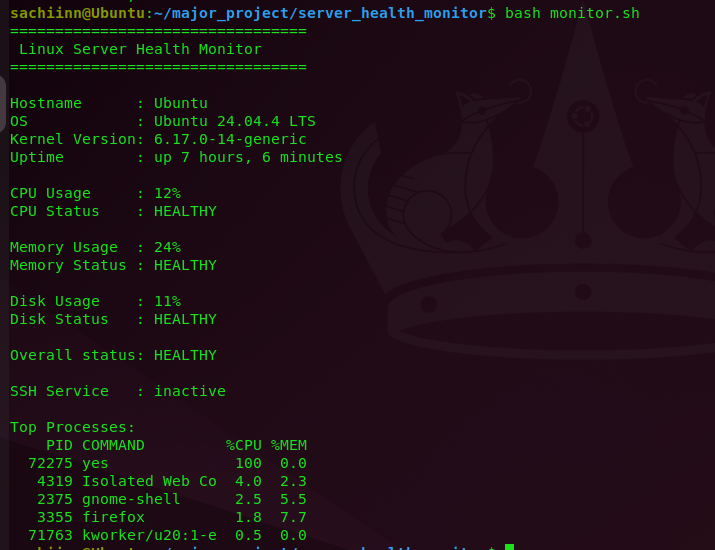
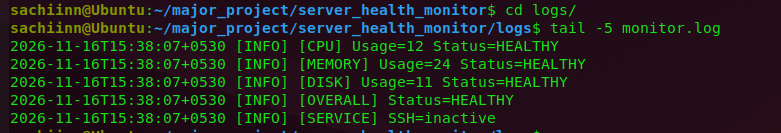
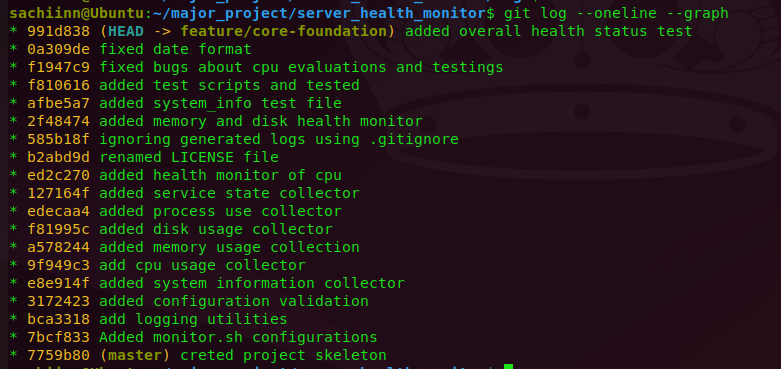
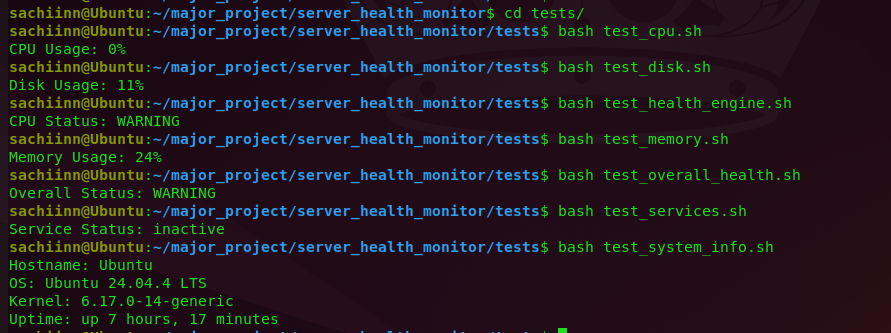

Linux Server Health Monitor
A modular Linux server monitoring solution developed using Bash scripting for monitoring system health, resource utilization, service availability, and operational status.

Project Overview
Linux system administrators frequently perform repetitive health checks to verify that servers are operating correctly. Monitoring CPU utilization, memory consumption, disk usage, critical services, and resource-intensive processes manually can be time-consuming and error-prone.

This project was developed to automate these operational checks and provide a consolidated health report from a single command-line interface.

The monitor collects important system metrics, evaluates them against configurable thresholds, generates health classifications, and writes timestamped logs for future analysis.

The project follows a modular architecture where each monitoring responsibility is implemented in a separate module, making the system easier to maintain, test, and enhance.

Problem Statement
Linux servers can experience:

High CPU utilization
Memory exhaustion
Disk space shortages
Failed or inactive services
Excessive resource consumption by processes
Administrators often need to execute multiple commands to investigate system health.

Examples:

top
free -h
df -h
ps aux
systemctl status service-name
Performing these checks repeatedly can increase administrative effort and may delay issue detection.

This project addresses this challenge by providing a centralized monitoring solution that combines multiple health checks into a single executable Bash application.

Objectives
The primary objectives of this project are:

Automate Linux server health monitoring.
Collect critical system metrics.
Evaluate system health using configurable thresholds.
Generate persistent operational logs.
Maintain a modular project structure.
Demonstrate practical Linux administration skills.
Demonstrate Bash scripting and Git workflow practices.
Provide a foundation for future monitoring enhancements.
Key Features
System Information Collection
Collects:

Hostname
Operating System Information
Kernel Version
System Uptime
CPU Monitoring
Collects CPU utilization percentage.
Evaluates CPU health using configurable thresholds.
Memory Monitoring
Collects memory usage statistics.
Calculates memory utilization percentage.
Disk Monitoring
Collects disk usage information.
Evaluates disk health against configured thresholds.
Process Monitoring
Displays top resource-consuming processes including:

Process ID (PID)
Process Name
CPU Usage
Memory Usage
Service Monitoring
Monitors critical services and reports their status.

Current implementation monitors:

ssh.service
Health Evaluation Engine
Classifies monitored resources into:

HEALTHY
WARNING
CRITICAL
Overall Health Status
Generates an overall server health status based on CPU, Memory, and Disk evaluations.

Logging
Generates timestamped operational logs and stores them for future analysis.

Testing
Includes standalone module-level test scripts for validating individual monitoring components.

Technologies Used
Bash Shell Scripting
Linux System Utilities
Git Version Control
Cron-ready Scheduling Design
Target Environment
Ubuntu Linux
Linux distributions supporting Bash
systemd-based environments

Project Structure
linux-server-health-monitor/
├── config/
│   └── monitor.conf
├── docs/
│   └── architecture.md
├── lib/
│   ├── config_validator.sh
│   ├── cpu.sh
│   ├── disk.sh
│   ├── health_engine.sh
│   ├── logging.sh
│   ├── memory.sh
│   ├── processes.sh
│   ├── services.sh
│   └── system_info.sh
├── logs/
├── screenshots/
├── tests/
├── monitor.sh
├── README.md
└── LICENSE
Module Responsibilities
Module	Responsibility
monitor.sh	Main entry point and orchestration
monitor.conf	Configuration management
config_validator.sh	Configuration validation
system_info.sh	Hostname, OS, kernel and uptime collection
cpu.sh	CPU utilization monitoring
memory.sh	Memory utilization monitoring
disk.sh	Disk utilization monitoring
processes.sh	Top process monitoring
services.sh	Service state monitoring
health_engine.sh	Health evaluation and overall health calculation
logging.sh	Timestamped logging
Configuration Reference
The monitoring behavior is controlled through the file:

config/monitor.conf
CPU Thresholds
Setting	Value
CPU_WARNING	70
CPU_CRITICAL	85
Memory Thresholds
Setting	Value
MEMORY_WARNING	75
MEMORY_CRITICAL	90
Disk Thresholds
Setting	Value
DISK_WARNING	75
DISK_CRITICAL	90
Monitoring Configuration
Setting	Value
CPU_SAMPLE_INTERVAL	1 second
TOP_PROCESS_COUNT	5
Logging Configuration
Setting	Value
LOG_FILE	./logs/monitor.log
Service Monitoring
CRITICAL_SERVICES=("ssh.service")
CHECK_FAILED_UNITS=true
Health Evaluation Logic
The monitoring system classifies resources into three health categories:

HEALTHY
Resource utilization remains below warning thresholds.

Example:

CPU Usage = 35%
Status = HEALTHY
WARNING
Resource utilization exceeds the warning threshold but remains below the critical threshold.

Example:

CPU Usage = 80%
Status = WARNING
CRITICAL
Resource utilization exceeds the critical threshold.

Example:

CPU Usage = 90%
Status = CRITICAL
Overall Health Evaluation
The system calculates an overall server health status using the following rules:

If any component is CRITICAL
    → Overall Status = CRITICAL

Else if any component is WARNING
    → Overall Status = WARNING

Else
    → Overall Status = HEALTHY
This provides administrators with a quick summary of server condition without analyzing individual metrics.

How to Run
Clone the repository:

git clone <repository-url>
Navigate to the project directory:

cd linux-server-health-monitor
Grant execution permission:

chmod +x monitor.sh
Run the monitor:

./monitor.sh
Sample Output
Example:

=================================
 Linux Server Health Monitor
=================================

Hostname      : Ubuntu
OS            : Ubuntu 24.04.4 LTS
Kernel Version: 6.17.0-14-generic
Uptime        : up 4 hours

CPU Usage     : 1%
CPU Status    : HEALTHY

Memory Usage  : 23%
Memory Status : HEALTHY

Disk Usage    : 11%
Disk Status   : HEALTHY

Overall Status: HEALTHY

SSH Service   : active
Testing
All major modules were tested individually before integration into the main monitoring workflow.

Available test scripts:

test_cpu.sh
test_memory.sh
test_disk.sh
test_services.sh
test_system_info.sh
test_health_engine.sh
test_overall_health.sh
Example test execution:

cd tests

bash test_cpu.sh
bash test_memory.sh
bash test_disk.sh
bash test_services.sh
Module-level testing helped verify functionality before combining all components into monitor.sh.

Screenshots

Logging
Monitoring results are stored in:

logs/monitor.log
Each execution creates timestamped log entries containing monitoring results and health status information.

Example:

2026-11-16T12:44:24+0530 [INFO] [CPU] Usage=1 Status=HEALTHY
2026-11-16T12:44:24+0530 [INFO] [OVERALL] Status=HEALTHY
Logs are appended instead of overwritten, allowing operational history to be preserved across multiple executions.

Git Workflow
The project was developed using a feature branch approach.

Development activities were performed in:

feature/core-foundation
while:

master
was preserved as the stable branch.

Changes were implemented incrementally through focused commits covering module development, testing, debugging, documentation, and final integration.

Cron Scheduling Support

The monitoring script is designed to support automated execution through Linux Cron.

Example Cron entry:

*/5 * * * * /absolute/path/to/linux-server-health-monitor/monitor.sh

This configuration executes the monitoring script every five minutes, allowing the system to periodically collect resource information, evaluate server health and append results to the monitoring log.

Current implementation status: The project is currently executed manually. Cron scheduling is supported as a possible deployment configuration but is not part of the current automated execution workflow.

Before enabling Cron, ensure that:

The script has executable permissions.

The correct absolute script path is configured.

The log directory is accessible to the executing user.

Required commands and environment settings are available in the Cron environment.

Future Enhancements

The following features can extend the monitoring capabilities in future versions:

Email notifications for critical server conditions.

Webhook-based alert integration.

Filesystem inode usage monitoring.

Automated log rotation and retention management.

Historical resource usage and trend analysis.

Prometheus metrics integration.

Grafana dashboard visualization.

Monitoring of additional system services.

Automated health report generation.

These enhancements are outside the scope of the current implementation.

Lessons Learned

Developing this project provided practical experience with:

Linux system administration and command-line operations.

Bash scripting and modular script development.

CPU, memory and disk resource monitoring.

Linux process inspection and systemd service management.

Configuration management and threshold validation.

Operational logging and error handling.

Git version control and repository maintenance.

Testing, debugging and troubleshooting.

Designing maintainable and reusable software components.

The project demonstrates how common Linux administration and monitoring tasks can be automated using modular Bash scripts, configurable thresholds and structured operational logging.

Author

Sachin N
