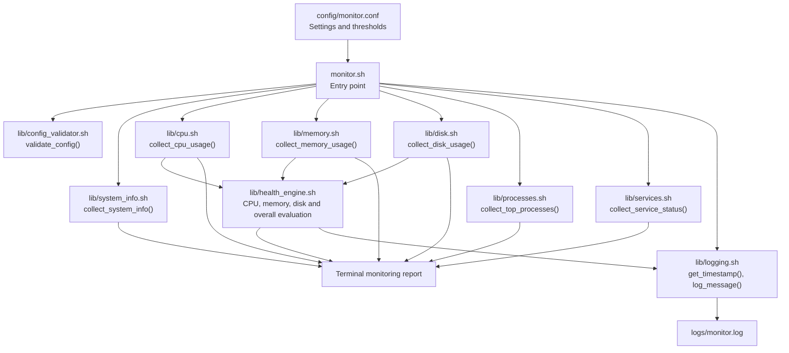
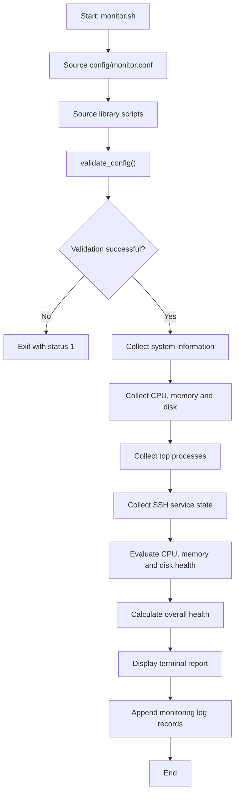

Linux Server Health Monitor
System Architecture Documentation
1. Document Purpose
This document describes the architecture and current implementation of
the Linux Server Health Monitor.

It is based on the source files in this repository:
- monitor.sh
- config/monitor.conf
- all scripts under lib/
- all scripts under tests/
The document distinguishes between implemented behavior, configuration
that is currently unused, and possible future enhancements. It does not
describe planned functionality as if it were already implemented.
2. System Overview
The Linux Server Health Monitor is a command-line monitoring utility
implemented in Bash. It collects selected information from a Linux host,
evaluates CPU, memory and root-filesystem utilization against
configurable thresholds, displays a monitoring report, and appends
timestamped records to a log file.

The current application is designed for a Linux environment with common
command-line utilities and systemd available for its SSH service check.
2.1 Current capabilities
The current source code implements the following:
- Hostname, operating-system name, kernel version and uptime
  collection.
- CPU utilization collection using vmstat.
- Memory utilization collection using free.
- Root filesystem utilization collection using df /.
- A list of the five highest CPU-consuming processes using ps.
- SSH service state collection using systemctl is-active ssh.
- CPU, memory and disk health classification using configurable
  warning and critical thresholds.
- Overall health classification based on CPU, memory and disk
  statuses.
- A terminal report.
- Timestamped append-only logging for CPU, memory, disk, overall
  status and SSH service status.
- Configuration validation for threshold ordering and positive
  sample/process-count settings.
- Standalone test scripts for selected modules and health-evaluation
  functions.
2.2 Current limitations to keep in mind
The following are important details of the current implementation:
- Disk collection checks only the root filesystem (/), not every
  mounted filesystem.
- Service collection checks the ssh service specifically.
- Service status is displayed and logged, but it is not included in
  the overall health calculation.
- The CRITICAL_SERVICES and CHECK_FAILED_UNITS configuration
  values are not currently consumed by lib/services.sh.
- CPU_SAMPLE_INTERVAL is configured, but lib/cpu.sh currently
  calls vmstat 1 2 directly.
- TOP_PROCESS_COUNT is configured, but lib/processes.sh currently
  uses head -n 6, producing a header plus five process rows.
- The health engine currently produces HEALTHY, WARNING or
  CRITICAL for CPU, memory, disk and overall status. It does not
  currently implement UNKNOWN or ERROR health states.
- The test scripts are simple execution/output checks. They do not
  currently contain automated assertions for expected values.
These limitations are documented so that the architecture matches the
code as it exists today.
3. High-Level Architecture
The application has a central entry point, a configuration file,
independent collection modules, a health evaluation module and a logging
module.
3.1 Logical architecture diagram

The diagram represents the responsibilities and data relationships
visible in the current source. The main script sources the modules,
invokes their functions, prints the report and calls the logging
function for each recorded result.
3.2 Main architectural components
  Component                           Main responsibility
  monitor.sh                        Loads configuration and modules,
coordinates execution, displays the
report and writes log entries

  config/monitor.conf               Stores thresholds and monitoring
settings

  lib/config_validator.sh           Checks selected configuration
relationships and positive values

  lib/system_info.sh                Collects host and operating-system
information

  lib/cpu.sh                        Collects CPU utilization

  lib/memory.sh                     Collects memory utilization

  lib/disk.sh                       Collects root filesystem
utilization

  lib/processes.sh                  Collects the top CPU-consuming
processes

  lib/services.sh                   Collects the SSH service state

  lib/health_engine.sh              Evaluates CPU, memory, disk and
overall health

  lib/logging.sh                    Formats and appends timestamped log
records
tests/                            Contains standalone scripts for
exercising individual modules and
health checks
4. Repository Structure
server_health_monitor/
├── config/
│   └── monitor.conf
├── docs/
│   └── architecture.md
├── lib/
│   ├── config_validator.sh
│   ├── cpu.sh
│   ├── disk.sh
│   ├── health_engine.sh
│   ├── logging.sh
│   ├── memory.sh
│   ├── processes.sh
│   ├── services.sh
│   └── system_info.sh
├── logs/
│   └── monitor.log
├── screenshots/
├── tests/
│   ├── test_cpu.sh
│   ├── test_disk.sh
│   ├── test_health_engine.sh
│   ├── test_memory.sh
│   ├── test_overall_health.sh
│   ├── test_services.sh
│   └── test_system_info.sh
├── LICENSE
├── monitor.sh
└── README.md
4.1 Directory responsibilities
- config/: runtime configuration values.
- docs/: project architecture documentation.
- lib/: reusable Bash functions grouped by responsibility.
- logs/: runtime monitoring log destination.
- screenshots/: project screenshots used by the README.
- tests/: standalone scripts used to execute and inspect module
  behavior.
- monitor.sh: main application entry point.
- README.md: project overview, setup, usage and project information.
- LICENSE: project license.
5. Configuration Architecture
File: config/monitor.conf

The main script sources this file before loading the library modules.
Its variables are therefore available to the functions invoked later by
monitor.sh.
5.1 Current configuration
  Variable                               Current value Intended purpose
  CPU_WARNING                                   70 CPU warning threshold

  CPU_CRITICAL                                  85 CPU critical
threshold

  MEMORY_WARNING                                75 Memory warning
threshold

  MEMORY_CRITICAL                               90 Memory critical
threshold

  DISK_WARNING                                  75 Disk warning
threshold

  DISK_CRITICAL                                 90 Disk critical
threshold

  CPU_SAMPLE_INTERVAL                            1 Configured CPU
sampling interval

  TOP_PROCESS_COUNT                              5 Configured number of
top processes

  LOG_FILE                      ./logs/monitor.log Log destination

  CRITICAL_SERVICES                ("ssh.service") Configured critical
service list
CHECK_FAILED_UNITS                          true Configured
failed-unit checking
option
5.2 Configuration validation
File: lib/config_validator.sh
Function: validate_config()

The validator currently checks:
1. CPU warning threshold is not greater than CPU critical threshold.
2. Memory warning threshold is not greater than memory critical
   threshold.
3. Disk warning threshold is not greater than disk critical threshold.
4. CPU sample interval is greater than zero.
5. Top process count is greater than zero.
The function returns success (0) when these checks pass and failure
(1) when a check fails. It prints an error message for a failed check.

The current validator does not check that thresholds are numeric and
within the range 0--100. It also does not validate the existence or
writability of the log destination.
5.3 Configuration values not currently applied
Although CPU_SAMPLE_INTERVAL, TOP_PROCESS_COUNT, CRITICAL_SERVICES
and CHECK_FAILED_UNITS exist in the configuration, the current
collection scripts do not use all of them:
- CPU sampling is currently specified directly in vmstat 1 2.
- The process collector currently uses a fixed five-row selection.
- The service collector checks ssh directly and does not read the
  configured service array.
- The service collector does not use CHECK_FAILED_UNITS to enumerate
  failed units.
The settings are recorded here because they exist in the current
configuration, but they should not be mistaken for active runtime
controls.
6. Application Execution Flow
Main file: monitor.sh

The current execution sequence is:
1. Source config/monitor.conf.
2. Source the configuration validator and logging module.
3. Source the system information, CPU, memory, disk, process and
   service modules.
4. Source the health evaluation module.
5. Run validate_config.
6. Exit with status 1 if configuration validation fails.
7. Collect system information.
8. Collect CPU utilization.
9. Collect memory utilization.
10. Collect root filesystem utilization.
11. Collect the top CPU-consuming processes.
12. Collect SSH service state.
13. Evaluate CPU health.
14. Evaluate memory health.
15. Evaluate disk health.
16. Calculate overall health from CPU, memory and disk statuses.
17. Print the monitoring report to the terminal.
18. Append five log records: CPU, memory, disk, overall status and SSH
    service state.
6.1 Execution flow diagram

This is the sequence implemented in monitor.sh. The individual
collection functions assign their results to shell variables, which are
then used by the health engine and report/logging sections.
7. Monitoring Module Architecture
7.1 System information
File: lib/system_info.sh
Function: collect_system_info()

The function collects:
- HOSTNAME using hostname.
- OS_NAME by reading the PRETTY_NAME value from /etc/os-release.
- KERNEL_VERSION using uname -r.
- UPTIME using uptime -p.
These values are displayed in the terminal report. The current main
script does not add a separate system-information record to the
operational log.
7.2 CPU monitoring
File: lib/cpu.sh
Function: collect_cpu_usage()

The function runs:
vmstat 1 2 | tail -1 | awk '{print 100-$15}'
The result is assigned to CPU_USAGE.

The implementation uses vmstat and extracts the idle percentage from
the final output row, then subtracts it from 100 to obtain the reported
CPU usage percentage.

The CPU health evaluation is performed separately by
check_cpu_health() in lib/health_engine.sh.

The current implementation uses the literal 1 2 arguments in the
vmstat command; it does not read CPU_SAMPLE_INTERVAL from the
configuration.
7.3 Memory monitoring
File: lib/memory.sh
Function: collect_memory_usage()

The function runs:
free | grep Mem | awk '{print int($3/$2 * 100)}'
The resulting integer percentage is assigned to MEMORY_USAGE.

The current implementation calculates the percentage using the used
and total fields in the free output. It does not explicitly use the
MemAvailable field.

The memory health evaluation is performed separately by
check_memory_health().
7.4 Disk monitoring
File: lib/disk.sh
Function: collect_disk_usage()

The function runs:
df / | awk 'NR==2 {print $5}' | tr -d '%'
The result is assigned to DISK_USAGE.

This checks the filesystem containing / only. It does not iterate over
all mounted filesystems or check inode utilization.

The disk health evaluation is performed separately by
check_disk_health().
7.5 Process monitoring
File: lib/processes.sh
Function: collect_top_processes()

The function runs:
ps -eo pid,comm,%cpu,%mem --sort=-%cpu | head -n 6
The output is assigned to TOP_PROCESSES.

The output contains the header and up to five process rows, sorted by
CPU usage in descending order. The fields include process ID, command
name, CPU percentage and memory percentage.

The current module reports process information; it does not classify
process health or terminate processes.
7.6 Service monitoring
File: lib/services.sh
Function: collect_service_status()

The function runs:
systemctl is-active ssh
The output is assigned to SERVICE_STATUS.

The current implementation checks the SSH service specifically. Its
state is displayed in the terminal report and appended to the log.

The service status is not passed into check_overall_health() and
therefore does not affect the current overall health classification.

The implementation does not currently enumerate all systemd services or
failed units.
8. Health Evaluation Architecture
File: lib/health_engine.sh

The health engine contains four functions:
- check_cpu_health()
- check_memory_health()
- check_disk_health()
- check_overall_health()
8.1 Component-level evaluation
Each component function compares its collected usage value with the
corresponding warning and critical thresholds.

The rule is:
If usage >= critical threshold:
    status = CRITICAL
Else if usage >= warning threshold:
    status = WARNING
Else:
    status = HEALTHY
The functions assign their results to:
- CPU_STATUS
- MEMORY_STATUS
- DISK_STATUS
The comparisons use Bash arithmetic evaluation.
8.2 Overall health evaluation
check_overall_health() evaluates only these three status variables:
- CPU_STATUS
- MEMORY_STATUS
- DISK_STATUS
The precedence is:
If any of CPU, memory or disk is CRITICAL:
    OVERALL_STATUS = CRITICAL
Else if any of CPU, memory or disk is WARNING:
    OVERALL_STATUS = WARNING
Else:
    OVERALL_STATUS = HEALTHY
The result is assigned to OVERALL_STATUS.
8.3 Example
  Component     Status
  CPU           HEALTHY
Memory        WARNING
Disk          HEALTHY
SSH service   inactive

The overall status is WARNING because memory is in the warning range.
The SSH service state is reported separately and does not change the
overall result in the current implementation.
8.4 Current health-engine scope
The health engine currently implements only HEALTHY, WARNING and
CRITICAL. It does not currently assign UNKNOWN or ERROR statuses.

The current overall calculation does not include process information,
system information or service status.
9. Logging Architecture
File: lib/logging.sh

The logging module defines two functions.
9.1 get_timestamp()
Returns a timestamp using:
date +"%Y-%m-%dT%H:%M:%S%z"
The timestamp includes the date, time and local UTC offset.
9.2 log_message()
Accepts three arguments:
1. Log level.
2. Component name.
3. Message.
It appends a formatted line to the file specified by LOG_FILE:
timestamp [level] [component] message
The append redirection (>>) preserves existing log records.
9.3 Records written by the main script
The current monitor.sh writes five records:
- CPU usage and CPU status.
- Memory usage and memory status.
- Disk usage and disk status.
- Overall health status.
- SSH service state.
System information and top-process output are displayed in the terminal
but are not separately written to the log by the current main script.

The configured log path is ./logs/monitor.log, which is relative to
the working directory from which the script is launched.
10. Testing Architecture
The tests/ directory contains standalone Bash scripts. Each script
sources the configuration or module it needs, invokes a function and
prints the resulting value or status.
  Test file                           Current behavior
  test_cpu.sh                       Sources configuration and CPU
module, runs CPU collection and
prints the usage

  test_memory.sh                    Runs memory collection and prints
the usage

  test_disk.sh                      Runs disk collection and prints the
usage

  test_services.sh                  Runs SSH service-state collection
and prints the result

  test_system_info.sh               Collects and prints hostname, OS,
kernel and uptime

  test_health_engine.sh             Sets CPU usage to 80, evaluates
CPU health and prints CPU status
test_overall_health.sh            Sets CPU, memory and disk statuses
to known values, evaluates overall
health and prints the result
10.1 Test execution
The test scripts use relative paths such as ../lib/cpu.sh. They are
therefore intended to be run from the tests/ directory, for example:
cd tests
bash test_cpu.sh
bash test_memory.sh
bash test_disk.sh
bash test_services.sh
bash test_system_info.sh
bash test_health_engine.sh
bash test_overall_health.sh
10.2 Testing scope and limitation
These scripts exercise the functions and display their output. They do
not currently use assertion statements to compare actual results with
expected results, and they do not provide a complete automated pass/fail
test framework.

The health-engine test uses a fixed CPU input of 80. The
overall-health test uses fixed component statuses. The collection tests
use the current host's live system information.
11. Error Handling and Operational Dependencies
The current implementation relies on external Linux utilities,
including:
- hostname
- grep
- cut
- uname
- uptime
- vmstat
- free
- df
- tr
- ps
- head
- systemctl
- date
- awk
The configuration validator returns a non-zero status for the
configuration conditions it checks, and monitor.sh exits if validation
fails.

The current collection functions do not consistently check command exit
statuses or validate that parsed output is non-empty and numeric. The
main script does not currently implement a general recovery mechanism
for missing utilities, unavailable services, collection failures or
log-write failures.

The logging function appends to LOG_FILE; successful log creation
depends on the destination directory existing and the executing user
having write permission.

These are current implementation limitations and potential areas for
future hardening.
12. Design Decisions
12.1 Modular Bash scripts
Monitoring responsibilities are separated into individual files under
lib/. This keeps the entry point focused on coordination and allows
individual functions to be sourced by standalone test scripts.
12.2 Central configuration
Thresholds and selected settings are stored in config/monitor.conf,
keeping configuration separate from collection and evaluation logic.
12.3 Separation of collection and evaluation
The CPU, memory and disk modules collect usage values. The health engine
evaluates those values separately against configured thresholds.
12.4 Read-only diagnostic behavior
The current monitoring modules collect and report information. They do
not automatically kill processes, restart services or change system
configuration.
12.5 Append-only logging
The logging function uses append redirection so records from earlier
executions remain in the log.
13. Current Limitations and Future Work
The following are not implemented in the current source code and should
be treated as possible future improvements:
- Monitoring all mounted filesystems rather than only /.
- Using the configured CPU sample interval in the CPU collector.
- Using the configured process count in the process collector.
- Reading the configured critical-service list.
- Checking all failed systemd units.
- Including service health in the overall health calculation.
- Adding explicit UNKNOWN and ERROR assessment states.
- Validating threshold numeric format and the 0--100 range.
- Checking dependencies and collection command failures.
- Validating log-directory and log-file access before execution.
- Adding assertion-based automated tests.
- Adding Cron scheduling, notifications, log rotation and historical
  metrics.
Cron scheduling is described in the README as a possible configuration,
but the current application does not install or configure a Cron job
itself.
14. Summary
The current Linux Server Health Monitor is a modular Bash application
coordinated by monitor.sh. It loads a central configuration, validates
selected settings, collects host information and selected resource
metrics, evaluates CPU, memory and root-filesystem utilization, displays
a terminal report and appends timestamped log records.

The current health engine bases overall health on CPU, memory and disk
status. Process and SSH service information are reported separately. The
test scripts provide basic module execution checks and sample
health-evaluation checks.

This document describes the implementation present in the reviewed
source files and identifies the differences between current behavior and
possible future enhancements.
